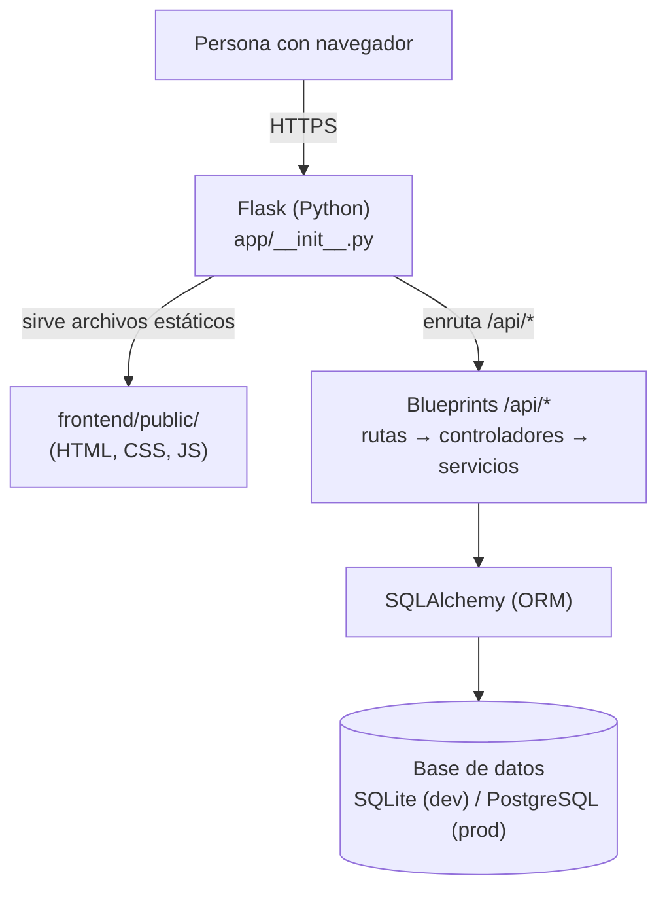
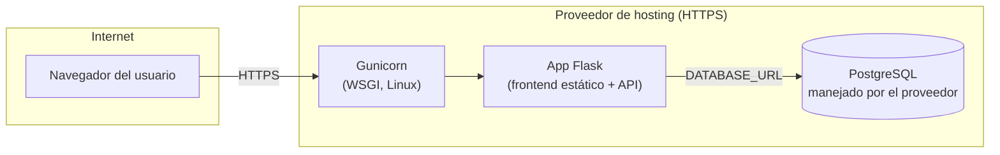

# ARQUITECTURA.md — Arquitectura de EncuentraU v1.0

> Este es el documento de arquitectura vigente. `ARCHITECTURE.md` (en la raíz del proyecto) describía un stack Node.js/Express/MySQL que fue reemplazado por completo por Flask desde v0.25 y quedó desactualizado (hallazgo de la auditoría, `docs/ESTADO_V025.md` sección 5); ahora solo redirige aquí.

## 1. Visión general

EncuentraU es una aplicación monolítica de dos capas: un frontend estático (HTML/CSS/JS vanilla) y un backend Flask con base de datos relacional, servidos **desde el mismo origen** (mismo dominio, mismo puerto) para evitar CORS innecesario y para que exista una sola URL pública.



## 2. Capas del backend (`backend/app/`)

```
routes/        → solo URL, método HTTP, decoradores de auth/rate-limit. Sin lógica.
controllers/   → lee la petición (request), valida forma básica, llama al service, arma la respuesta JSON.
services/      → TODA la lógica de negocio y validación real. No conoce Flask (sin `request`, sin `jsonify`).
models/        → clases SQLAlchemy (datos) + funciones de acceso a datos simples (crear/buscar).
middlewares/   → autorizacion.py (decoradores login/admin), manejo_errores.py (handlers globales).
config/        → config.py, toda la configuración sale de variables de entorno.
extensions.py  → instancias compartidas (db, migrate, limiter, csrf) sin la app todavía, para evitar imports circulares.
```

Ejemplo de flujo de una petición (`POST /api/objetos`):

```mermaid
sequenceDiagram
    participant F as Frontend (fetch)
    participant R as routes/objetos_routes.py
    participant M as middlewares/autorizacion.py
    participant C as controllers/objetos_controller.py
    participant S as services/objetos_service.py
    participant D as models/objeto.py (SQLAlchemy)
    participant BD as Base de datos

    F->>R: POST /api/objetos + cookie sesión + X-CSRFToken
    R->>M: @login_requerido
    M->>D: buscar_por_id(usuario_id de la sesión)
    D->>BD: SELECT usuarios WHERE id=?
    BD-->>D: usuario
    M-->>R: usuario autenticado (o 401)
    R->>C: crear(usuario_actual)
    C->>S: crear_objeto(usuario.id, datos)
    S->>S: validar_datos_objeto()
    S->>D: db.session.add(objeto); commit()
    D->>BD: INSERT INTO objetos
    S-->>C: objeto creado
    C-->>F: 201 {mensaje, objeto}
```

## 3. Frontend (`frontend/public/`)

Sin build step, sin framework: HTML + CSS + JS vanilla, servidos como archivos estáticos por el propio Flask (`static_folder=frontend/public, static_url_path=''`). Cada página de negocio tiene su propio archivo `js/pagina-*.js` (nunca `<script>` inline, para poder aplicar una Content-Security-Policy estricta — ver `SECURITY.md`).

```
js/api.js       → fetch con manejo de CSRF y credenciales (cookies). API_BASE='/api' (mismo origen).
js/sesion.js     → obtenerSesion(), protegerPagina({admin}), logout real.
js/main.js       → helpers compartidos: resaltar nav activo, crearElemento/crearBadge (DOM seguro, sin innerHTML con datos de usuario).
js/validaciones.js, js/contrasena-fortaleza.js → validación visual (UX), nunca la autoridad.
js/pagina-*.js   → un archivo por página con lógica específica (login, registro, reportar, buscar, detalle, mis-reportes, paneles admin...).
```

## 4. Base de datos

Ver `docs/DATABASE.md` para el esquema completo. Resumen: 4 tablas (`usuarios`, `tokens_recuperacion`, `objetos`, `solicitudes`), SQLAlchemy como ORM, Flask-Migrate/Alembic para migraciones versionadas, SQLite en desarrollo y PostgreSQL en producción (vía `DATABASE_URL`).

## 5. Por qué mismo origen (no microservicios, no subdominios separados)

La misión de v1.0 pide explícitamente **una sola URL pública**. Servir el frontend estático desde el mismo proceso Flask que la API:
- Elimina la necesidad de CORS en producción (`Access-Control-Allow-Origin` solo se configura para el caso de desarrollo con dos servidores en paralelo, puerto 5000 y 5500).
- Simplifica el despliegue: un solo servicio, un solo dominio, una sola configuración de HTTPS.
- Es coherente con "simplicidad académica, no perfecta en abstracto" (CLAUDE.md): un monolito bien organizado en capas es más fácil de entender, desplegar y depurar para un estudiante que una arquitectura de microservicios.

## 6. Diagrama de despliegue objetivo



Ver `docs/DEPLOYMENT.md` para el estado real de este despliegue (qué está preparado y qué falta por autorización externa).

## 7. Decisiones que se mantienen de v0.25

- Blueprint pattern para las rutas de Flask.
- Patrón de extensiones compartidas sin la app (`extensions.py`) para evitar imports circulares.
- Estilo de mensajes de error en español, formato `{mensaje, errores?}`.
- Identidad visual del frontend (paleta de colores, logo, estructura de páginas) — no se rediseñó, solo se conectó a datos reales.

Ver también `docs/DIAGRAMAS.md`: entidad-relación, casos de uso, clases y actividad del proceso de reclamación.

## 8. Decisiones nuevas en v1.0

- SQLAlchemy + Flask-Migrate reemplazan el almacenamiento en listas de Python.
- Argon2id reemplaza scrypt (Werkzeug) para el hashing de contraseñas.
- Cuatro nuevos módulos de negocio completos: objetos, solicitudes, coincidencias, administración de usuarios/reportes/solicitudes.
- Cabeceras de seguridad (CSP y otras) — obligó a mover toda la lógica JS inline a archivos externos.
- Frontend y backend servidos desde el mismo origen (antes: dos servidores de desarrollo separados).
