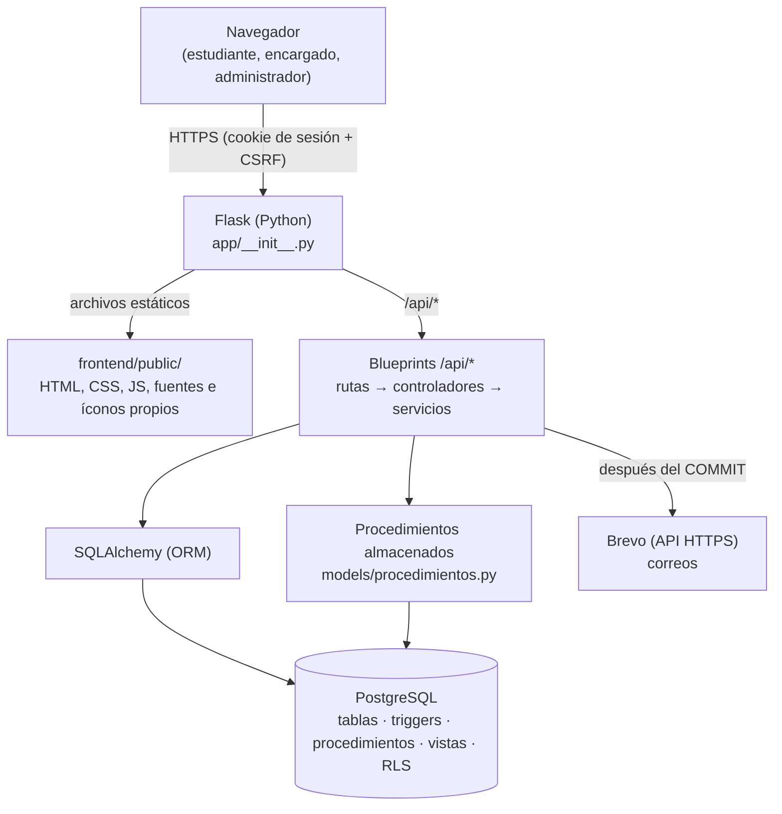
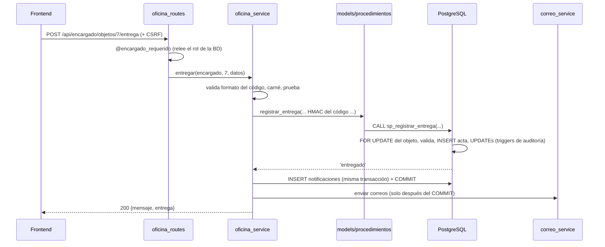
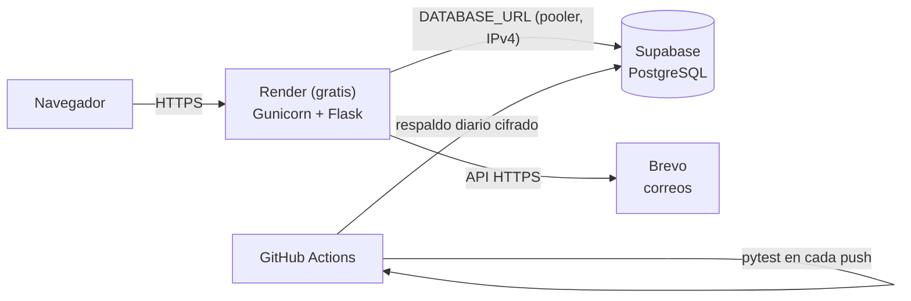

# ARQUITECTURA.md — Arquitectura de EncuentraU v2.0

> Documento de arquitectura vigente. `ARCHITECTURE.md` (en la raíz) describe un stack Node.js antiguo y se conserva solo como historia.

## 1. Visión general

Monolito de dos capas: frontend estático (HTML/CSS/JS vanilla) y backend Flask, servidos **desde el mismo origen**, con PostgreSQL como base de datos. Buena parte de las reglas críticas (estados, límites, entregas, auditoría, permisos) vive **también** dentro de PostgreSQL, como defensa en profundidad.



## 2. Capas del backend (`backend/app/`)

```
routes/        URL, método HTTP y protección: @estudiante_requerido, @encargado_requerido,
               @admin_requerido, @login_requerido y límites de peticiones. Sin lógica.
controllers/   leen la petición, verifican ownership, llaman al servicio y arman el JSON.
services/      toda la lógica de negocio y la validación definitiva. No conocen Flask.
models/        clases SQLAlchemy que reflejan el esquema SQL + procedimientos.py y
               reportes.py (únicos lugares con SQL escrito a mano, siempre parametrizado).
middlewares/   autorizacion.py (decoradores por rol), manejo_errores.py (traduce los
               errores de PostgreSQL: P0001 → 409 con el mensaje de la regla, etc.).
config/        config.py: todo sale de variables de entorno; valida la configuración al arrancar.
auditoria_contexto.py   le dice a PostgreSQL quién hace cada cambio (set_config por transacción).
seguridad.py   tokens, hashes y códigos de retiro (módulo secrets, SHA-256, HMAC).
comandos.py    flask crear-admin / verificar-correo / vencer-reservas.
```

| Módulo | Servicios principales |
|---|---|
| Cuentas | `cuentas_service` (registro, verificación, recuperación), `auth_service` (contraseñas, dominio) |
| Reportes | `objetos_service`, `coincidencias_service` |
| Reclamaciones del estudiante | `solicitudes_service` |
| Oficina (encargado) | `oficina_service` → procedimientos almacenados |
| Administración | `usuarios_admin_service`, `catalogos_service`, `auditoria_service` (incluye CSV) |
| Avisos | `notificaciones_service`, `correo_service` |

**Patrón de una operación del encargado** (ejemplo: entrega):



## 3. Frontend (`frontend/public/`)

Sin build step ni framework. Identidad visual inspirada en sanmateo.edu.co (Poppins, naranja institucional, azul marino), con fuentes e íconos servidos desde el propio servidor para cumplir la CSP (`script-src 'self'`, `style-src 'self'`, sin `unsafe-inline`). Detalle en `docs/FRONTEND.md`.

```
js/layout.js   arma encabezado, menú por rol y pie en todas las páginas; expone la promesa sesionLista
js/api.js      fetch con credenciales y CSRF
js/main.js     el() para construir el DOM de forma segura (nunca innerHTML), fechas, insignias, tarjetas
js/pagina-*.js un archivo por página
```

## 4. Base de datos

PostgreSQL en desarrollo, pruebas y producción. 14 tablas normalizadas a 3FN, triggers, procedimientos almacenados, vistas, índices especializados, permisos mínimos y RLS. Ver `docs/DATABASE.md` y el diagrama entidad-relación en `docs/DIAGRAMAS.md`.

## 5. Despliegue objetivo



Estado real: **pendiente** (la base de datos gratuita de Render venció; el cambio a Supabase todavía no se ha hecho). Ver `docs/DEPLOYMENT.md`.

## 6. Decisiones

**Se mantienen de v1.0**: mismo origen para frontend y API; Blueprints; `extensions.py` contra imports circulares; mensajes de error en español con formato `{mensaje, errores?}`; Argon2id; CSRF; cabeceras de seguridad.

**Nuevas en v2.0**:
- PostgreSQL en todos los entornos (SQLite no tiene procedimientos, permisos ni RLS).
- Esquema escrito en SQL legible (`backend/migrations/sql/`) en vez de generado desde las clases: es más fácil de explicar y de reutilizar en el editor SQL de Supabase.
- Reglas críticas duplicadas a propósito en la base de datos (triggers, procedimientos, índices únicos parciales): aunque Python tuviera un bug, los datos no quedan inconsistentes.
- Tres roles con funciones separadas en lugar de "ciudadano/administrador".
- Dos usuarios de base de datos (dueño y aplicación) en lugar de uno.
- Correos reales (verificación, recuperación, avisos) con un patrón de dos pasos: la notificación se guarda en la transacción del cambio y el correo se envía después del `COMMIT`.
- Rediseño completo del frontend con el estilo del sitio de la universidad.
