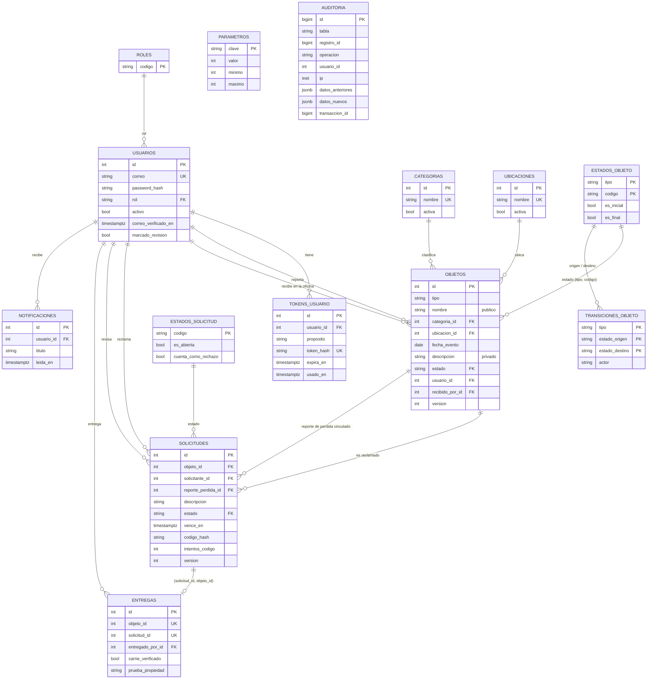
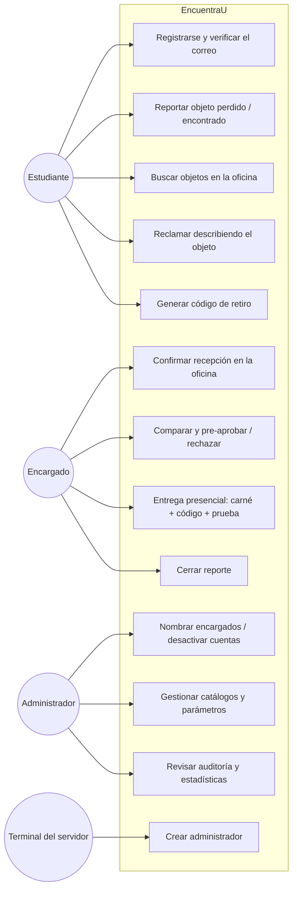
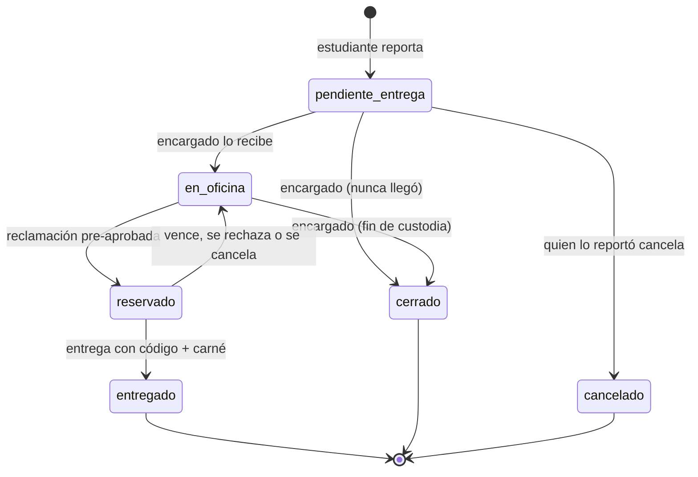
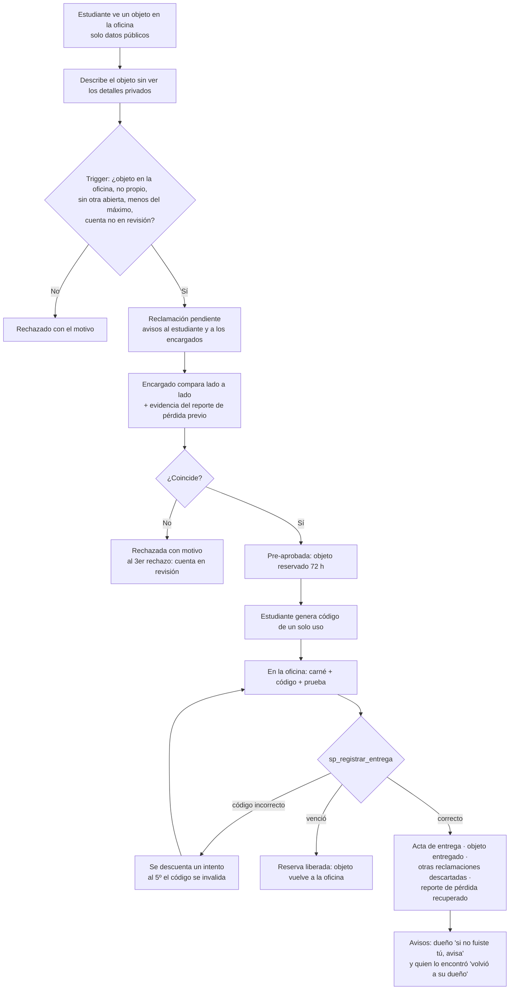

# DIAGRAMAS.md — Diagramas de EncuentraU v2.0

Arquitectura, secuencia de una entrega y despliegue: `docs/ARQUITECTURA.md`. Aquí: entidad-relación, casos de uso por rol, estados y actividad del proceso de reclamación, y autenticación. (Los diagramas usan Mermaid: GitHub los dibuja automáticamente.)

## 1. Entidad-relación (esquema real de `backend/migrations/sql/01_tablas.sql`)



`AUDITORIA` y `PARAMETROS` no tienen relaciones a propósito: la auditoría no debe depender de otras tablas, y los parámetros los leen los triggers por su clave.

## 2. Casos de uso por rol



## 3. Estados de un objeto encontrado (tabla `transiciones_objeto`)



Objeto perdido: `buscando` → `recuperado` (al entregarle un objeto con ese reporte vinculado) · `cancelado` · `cerrado`.

## 4. Actividad — de la reclamación a la entrega



## 5. Autenticación con verificación de correo

```mermaid
sequenceDiagram
    participant N as Navegador
    participant F as Flask
    participant BD as PostgreSQL
    participant M as Correo

    N->>F: POST /api/auth/registro (correo @sanmateo.edu.co)
    F->>F: valida + Argon2id (siempre, exista o no la cuenta)
    F->>BD: INSERT usuario (estudiante, sin verificar) + hash del token
    F->>M: enlace verificar-correo.html?token=…
    F-->>N: 201 (misma respuesta exista o no la cuenta)
    N->>F: POST /api/auth/verificar-correo {token}
    F->>BD: busca por SHA-256(token), válido y sin usar → marca usado + verificado
    N->>F: POST /api/auth/login
    alt contraseña correcta y correo verificado
        F->>F: session.clear(); session['usuario_id'] = id
        F-->>N: 200 {usuario, csrf_token nuevo}
    else contraseña correcta, correo sin verificar
        F-->>N: 403 correo_no_verificado
    else credenciales inválidas
        F-->>N: 401 mensaje genérico
    end
```
