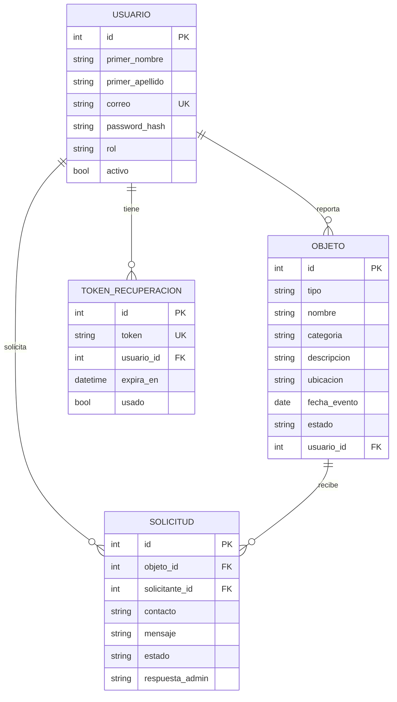
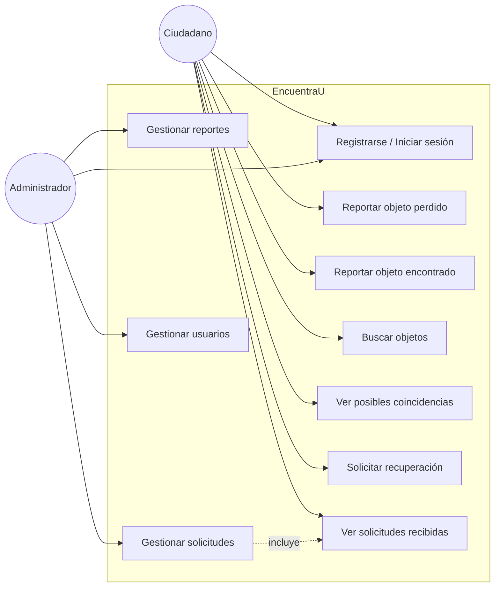
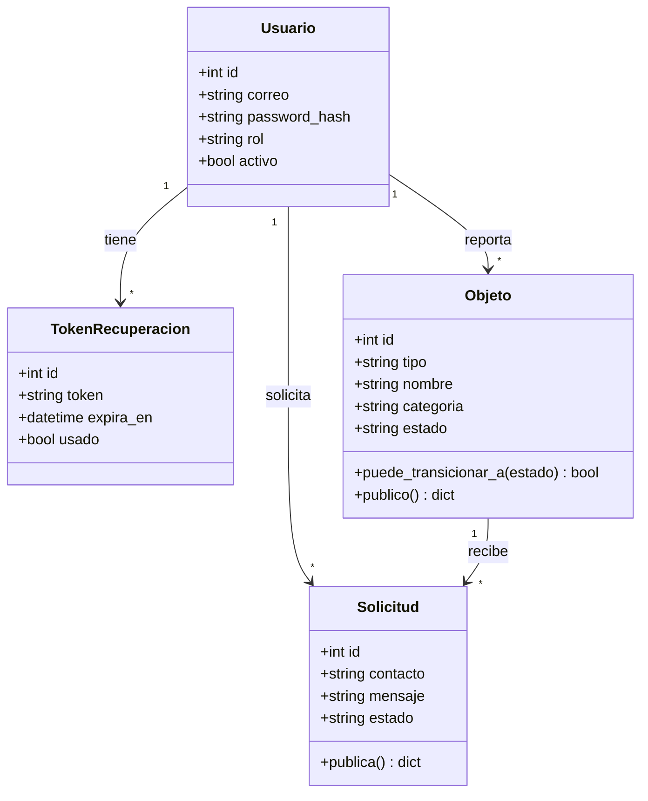
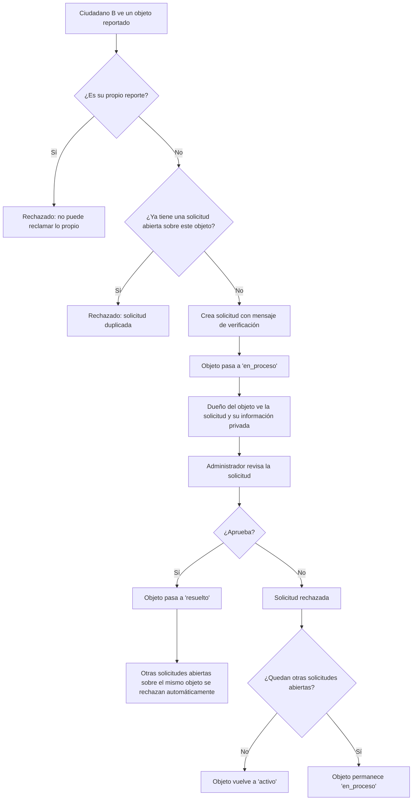

# DIAGRAMAS.md — Diagramas complementarios de EncuentraU v1.0

Los diagramas de arquitectura de componentes, secuencia (creación de un reporte) y despliegue ya están en `docs/ARQUITECTURA.md`. Este documento agrega los que faltaban: entidad-relación, casos de uso, clases y actividad del proceso de reclamación.

## 1. Entidad-relación



## 2. Casos de uso



## 3. Clases (modelos del backend)



## 4. Actividad — proceso de reclamación (de solicitud a resolución)



## 5. Autenticación (secuencia)

```mermaid
sequenceDiagram
    participant N as Navegador
    participant F as Flask (auth_controller)
    participant S as auth_service (Argon2id)
    participant BD as Base de datos

    N->>F: GET /api/auth/csrf-token
    F-->>N: csrf_token

    N->>F: POST /api/auth/login (correo, contraseña, X-CSRFToken)
    F->>BD: buscar_por_correo(correo)
    BD-->>F: Usuario o None
    F->>S: verificar_password(contraseña, hash)
    S-->>F: True/False
    alt credenciales válidas y cuenta activa
        F->>F: session.clear(); session['usuario_id'] = id
        F-->>N: 200 {usuario, csrf_token nuevo}
    else inválidas
        F-->>N: 401 {mensaje genérico}
    end
```
